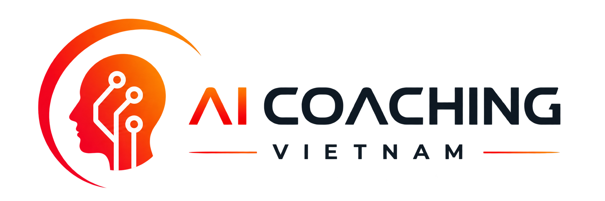

<div align="center">



# AI Coaching Vietnam — LMS Platform
### Hệ thống Quản trị & Đào tạo Thực chiến Chuyên sâu về Thuế, Kế toán và Tài chính Doanh nghiệp

[](https://frappeframework.com/)
[](https://vuejs.org/)
[](license.txt)
[](https://payos.vn/)
[](https://ai.google.dev/)
[-red.svg)](#bản-địa-hóa--trải-nghiệm-người-dùng)

<p align="center">
  <b>Nền tảng học trực tuyến hiện đại, tích hợp Trợ lý AI tư vấn tự động 24/7 và cổng thanh toán tự động VietQR (PayOS) dành riêng cho đào tạo thực chiến tại Việt Nam.</b>
</p>

</div>

---

## 📑 Mục lục

- [Tổng quan dự án](#-tổng-quan-dự-án)
- [Tính năng nổi bật](#-tính-năng-nổi-bật)
  - [1. Trợ lý AI Tư vấn thông minh](#1-trợ-lý-ai-tư-vấn-thông-minh-ai-coach)
  - [2. Cổng thanh toán VietQR tự động qua PayOS](#2-cổng-thanh-toán-vietqr-tự-động-qua-payos)
  - [3. Quản trị Đào tạo chuyên sâu](#3-quản-trị-đào-tạo-chuyên-sâu-lms-core)
  - [4. Bản địa hóa & Trải nghiệm người dùng](#4-bản-địa-hóa--trải-nghiệm-người-dùng)
- [Kiến trúc Công nghệ](#-kiến-trúc-công-nghệ)
- [Cấu trúc Thư mục](#-cấu-trúc-thư-mục)
- [Hướng dẫn Cài đặt & Khởi chạy](#-hướng-dẫn-cài-đặt--khởi-chạy)
  - [Cách 1: Triển khai nhanh bằng Docker (Khuyến nghị)](#cách-1-triển-khai-nhanh-bằng-docker-khuyến-nghị)
  - [Cách 2: Cài đặt trên môi trường Frappe Bench](#cách-2-cài-đặt-trên-môi-trường-frappe-bench)
- [Cấu hình Tích hợp](#-cấu-hình-tích-hợp)
  - [Cấu hình AI Chatbot (Google Gemini)](#cấu-hình-ai-chatbot-google-gemini)
  - [Cấu hình Cổng thanh toán PayOS](#cấu-hình-cổng-thanh-toán-payos)
- [Kiểm thử (Testing)](#-kiểm-thử-testing)
- [Quy chuẩn Đóng góp (Contribution)](#-quy-chuẩn-đóng-góp-contribution)
- [Giấy phép (License)](#-giấy-phép-license)

---

## 🌟 Tổng quan dự án

**AI Coaching Vietnam LMS** (`lms-ai-tax-coaching`) là hệ thống quản lý học tập (Learning Management System) toàn diện, phát triển trên nền tảng **Frappe Framework** và **Frappe UI (Vue 3 Single Page Application)**.

Hệ thống được thiết kế và tối ưu riêng cho nhu cầu đào tạo và huấn luyện thực chiến trong các lĩnh vực:
* 📊 **Thuế & Chính sách thuế thực chiến**
* 📑 **Kế toán doanh nghiệp & Lập báo cáo tài chính**
* 🔍 **Kiểm toán nội bộ & Soát xét hồ sơ thuế**
* 📈 **Quản trị Tài chính & Dòng tiền doanh nghiệp**
* 👥 **Quản trị Nhân sự & Tiền lương**
* 🏢 **Quản trị & Điều hành Doanh nghiệp**

Phiên bản này được bản địa hóa hoàn toàn bằng **Tiếng Việt**, tích hợp **Thanh toán tự động qua QR Napas247 (PayOS)** và **Trợ lý tư vấn AI (Google Gemini)** nhằm mang lại trải nghiệm tối ưu nhất cho học viên và ban điều hành tại Việt Nam.

---

## ✨ Tính năng nổi bật

### 1. Trợ lý AI Tư vấn thông minh (AI Coach)
* **Tư vấn tự động 24/7**: Chatbot thông minh hiển thị tại Landing Page và các trang khóa học, sẵn sàng giải đáp thắc mắc của học viên về chương trình, học phí, lịch học.
* **Context-Aware Dynamic Data**: AI tự động truy xuất dữ liệu thời gian thực từ cơ sở dữ liệu LMS (các khóa học đang mở, các lớp học sắp khai giảng, ưu đãi học phí) để cung cấp câu trả lời chính xác, trung thực.
* **An toàn & Bảo mật**: Tích hợp bộ lọc câu hỏi ngoài phạm vi đào tạo, bảo vệ dữ liệu nhạy cảm của hệ thống và giới hạn tốc độ truy vấn (Rate Limiter).

### 2. Cổng thanh toán VietQR tự động qua PayOS
* **Thanh toán tức thì 24/7**: Tự động tạo mã QR động VietQR (chuẩn Napas247) cho từng đơn đăng ký khóa học hoặc lớp học (Batch).
* **Xác thực Webhook an toàn**: Kiểm tra tính toàn vẹn dữ liệu giao dịch bằng chữ ký số HMAC-SHA256 chuẩn PayOS.
* **Tự động kích hoạt (Auto-Enrollment)**: Ngay khi học viên chuyển khoản thành công, hệ thống tự động ghi nhận thanh toán và mở quyền truy cập khóa học cho học viên mà không cần phê duyệt thủ công.

### 3. Quản trị Đào tạo chuyên sâu (LMS Core)
* **Cấu trúc khóa học 3 cấp độ**: *Khóa học (Course) → Chương (Chapter) → Bài học (Lesson)*, kết hợp linh hoạt video bài giảng, tài liệu PDF, bài đọc đa phương tiện.
* **Quản lý Lớp học theo kỳ (Batches)**:
  * Tổ chức lớp học đồng hành có giảng viên hướng dẫn.
  * Tích hợp lịch học trực tuyến Zoom, quản lý điểm danh và theo dõi tiến độ từng học viên.
* **Hệ thống Bài tập & Đánh giá (Quizzes & Assessments)**:
  * Trắc nghiệm một đáp án, nhiều đáp án, câu hỏi mở.
  * Chống gian lận (Proctoring) với cơ chế giám sát vi phạm và chấm điểm tự động.
* **Cấp chứng chỉ điện tử (E-Certificates)**:
  * Tự động tạo chứng chỉ PDF sắc nét kèm mã định danh duy nhất (UUID).
  * Trang tra cứu và xác thực chứng chỉ trực tuyến công khai.

### 4. Bản địa hóa & Trải nghiệm người dùng
* **Giao diện Guest Landing Page**: Tinh tế, chuyên nghiệp, hiển thị trực quan các khóa học nổi bật và danh mục đào tạo theo chủ đề.
* **Chuẩn tiền tệ Việt Nam**: Mặc định VND, định dạng dấu phân cách chuẩn `1.000.000 đ`.
* **100% Tiếng Việt**: Hệ thống ngôn ngữ được dịch chuẩn xác, thân thiện với học viên và giảng viên Việt Nam.
* **Tối ưu hóa kiến trúc**: Loại bỏ các tính năng không phù hợp (IDE code bài tập lập trình, bảng tin tuyển dụng) giúp hệ thống nhẹ nhàng, tốc độ tải trang cực nhanh.

---

## 🛠 Kiến trúc Công nghệ

```
                   ┌────────────────────────────────────────┐
                   │    Client (Web / Mobile Browser)       │
                   └──────────────────┬─────────────────────┘
                                      │
                         HTTP / REST API / WebSockets
                                      │
                   ┌──────────────────▼─────────────────────┐
                   │   Vue 3 SPA (Frappe UI + Tailwind CSS) │
                   │   - Guest Landing Page & Course Pages  │
                   │   - Learner Dashboard & Quiz Engine    │
                   │   - AI Chatbot Widget (Floating)       │
                   └──────────────────┬─────────────────────┘
                                      │
                               REST / RPC API
                                      │
                   ┌──────────────────▼─────────────────────┐
                   │        Frappe Backend (Python)         │
                   │   - LMS Core Controllers & Doctypes    │
                   │   - AI Coach Service (Gemini API)      │
                   │   - PayOS VietQR Webhook & Enrollment  │
                   └──────────┬───────────────────┬─────────┘
                              │                   │
               ┌──────────────▼──────┐     ┌──────▼──────────────┐
               │  MariaDB (Database) │     │ Redis (Cache/Queue) │
               └─────────────────────┘     └─────────────────────┘
```

| Tầng | Công nghệ sử dụng |
|---|---|
| **Backend** | [Frappe Framework](https://frappeframework.com/) (Python 3.10+ / 3.14), WSGI/Gunicorn |
| **Frontend** | [Vue 3](https://vuejs.org/), [Frappe UI](https://github.com/frappe/frappe-ui), [Vite](https://vitejs.dev/), Tailwind CSS, TypeScript, Pinia |
| **Database & Cache** | MariaDB 10.8+, Redis Cache & Redis Queue |
| **Thanh toán** | [PayOS](https://payos.vn/) API v2 (VietQR / Napas247 Open Banking) |
| **Trí tuệ nhân tạo** | [Google Gemini 1.5 Flash](https://ai.google.dev/) API |
| **Testing** | Vitest (Frontend), Python `unittest` (Backend), Playwright (E2E) |

---

## 📂 Cấu trúc Thư mục

```text
lms-ai-tax-coaching/
├── docker/                      # Cấu hình triển khai nhanh bằng Docker Compose
│   ├── docker-compose.yml       # Định nghĩa container MariaDB, Redis, Frappe Bench
│   └── init.sh                  # Script khởi tạo site và cài đặt ứng dụng
├── frontend/                    # Single Page Application (Vue 3 + Frappe UI)
│   ├── src/
│   │   ├── components/
│   │   │   ├── AiChatbot/       # Giao diện widget tư vấn AI cho học viên
│   │   │   └── Public/          # Header, footer dành cho khách
│   │   ├── pages/
│   │   │   ├── Home/GuestHome.vue # Trang chủ Landing Page chuẩn cho khách
│   │   │   ├── Courses/         # Danh sách và chi tiết khóa học
│   │   │   └── Batches/         # Danh sách lớp học và quản lý học viên
│   │   └── utils/               # Tiện ích định dạng tiền tệ VND, thời gian...
│   └── tests/                   # Bộ kiểm thử Unit test cho Frontend (Vitest)
├── lms/                         # Backend Frappe App
│   ├── lms/
│   │   ├── doctype/             # Định nghĩa DocType (LMS Course, LMS Batch, PayOS Settings...)
│   │   ├── integrations/        # Xử lý kết nối PayOS, Webhook VietQR
│   │   ├── ai_coach.py          # Xử lý nghiệp vụ Trợ lý AI (Gemini API)
│   │   ├── api.py               # Các REST API công khai & bảo mật
│   │   └── permissions.py       # Phân quyền chặt chẽ theo học viên, giảng viên, quản trị
│   ├── translations/
│   │   └── vi.csv               # Tệp dịch thuật giao diện tiếng Việt hoàn chỉnh
│   └── tests/                   # Bộ kiểm thử tự động cho Backend
├── e2e/                         # Kiểm thử tự động E2E với Playwright
└── hooks.py                     # Cấu hình sự kiện, quyền và hooks của Frappe
```

---

## 🚀 Hướng dẫn Cài đặt & Khởi chạy

### Cách 1: Triển khai nhanh bằng Docker (Khuyến nghị)

Yêu cầu máy chủ đã cài đặt **Docker** và **Docker Compose**.

1. **Clone mã nguồn về máy**:
   ```bash
   git clone https://github.com/ntu254/lms-ai-tax-coaching.git
   cd lms-ai-tax-coaching/docker
   ```

2. **Khởi động các dịch vụ**:
   ```bash
   docker compose up -d
   ```
   > Quá trình khởi tạo ban đầu (`init.sh`) sẽ thiết lập MariaDB, Redis, khởi tạo site `lms.localhost` và cài đặt ứng dụng. Quá trình này mất khoảng 3 - 5 phút trong lần chạy đầu tiên.

3. **Truy cập hệ thống**:
   * Địa chỉ trang đào tạo: [http://localhost:8000/lms](http://localhost:8000/lms)
   * Tài khoản quản trị mặc định:
     * **Email / Tên đăng nhập**: `Administrator`
     * **Mật khẩu**: `admin`

---

### Cách 2: Cài đặt trên môi trường Frappe Bench

Dành cho nhà phát triển muốn tùy chỉnh trực tiếp mã nguồn trên máy chủ đã có sẵn `bench`.

1. **Tạo site mới hoặc sử dụng site hiện có**:
   ```bash
   bench new-site learning.local
   bench --site learning.local add-to-hosts
   ```

2. **Tải và cài đặt các ứng dụng phụ thuộc**:
   ```bash
   bench get-app payments
   bench get-app https://github.com/ntu254/lms-ai-tax-coaching.git lms
   ```

3. **Cài đặt ứng dụng vào site**:
   ```bash
   bench --site learning.local install-app payments
   bench --site learning.local install-app lms
   ```

4. **Biên dịch Frontend (Single Page Application)**:
   ```bash
   cd apps/lms/frontend
   yarn install
   yarn build
   ```

5. **Khởi chạy máy chủ phát triển**:
   ```bash
   # Tại thư mục gốc của frappe-bench
   bench start
   ```

   Mở trình duyệt tại: `http://learning.local:8000/lms`

---

## ⚙️ Cấu hình Tích hợp

### Cấu hình AI Chatbot (Google Gemini)

Để kích hoạt tính năng trợ lý AI tư vấn khóa học tự động:

1. Đăng ký nhận API Key miễn phí tại [Google AI Studio](https://aistudio.google.com/).
2. Cấu hình vào file cấu hình site `site_config.json`:
   ```json
   {
     "gemini_api_key": "YOUR_GEMINI_API_KEY_HERE"
   }
   ```
   *Hoặc đặt biến môi trường:*
   ```bash
   export GEMINI_API_KEY="YOUR_GEMINI_API_KEY_HERE"
   ```

### Cấu hình Cổng thanh toán PayOS

1. Đăng ký tài khoản doanh nghiệp hoặc cá nhân tại [PayOS](https://payos.vn/).
2. Đăng nhập vào giao diện Quản trị Frappe Desk (`/app`) với quyền `System Manager`.
3. Tìm kiếm DocType **PayOS Settings**:
   * Tích chọn **Bật cổng thanh toán (Enabled)**.
   * Điền **Client ID**, **API Key** và **Checksum Key** do PayOS cấp.
   * Thiết lập URL Webhook trên trang quản trị PayOS:
     ```
     https://<ten-mien-cua-ban>/api/method/lms.lms.integrations.payos.payos_webhook
     ```
4. Lưu cấu hình. Giờ đây, khi học viên đăng ký khóa học, hệ thống sẽ tự động xuất hóa đơn kèm mã QR thanh toán ngân hàng.

---

## 🧪 Kiểm thử (Testing)

Hệ thống có đầy đủ bộ kiểm thử tự động đảm bảo độ ổn định cao:

```bash
# 1. Chạy Backend Unit Tests (từ thư mục frappe-bench)
bench --site learning.local run-tests --app lms

# 2. Chạy riêng kiểm thử tích hợp PayOS & Bản địa hóa
python -m unittest lms/tests/test_payos_integration.py

# 3. Chạy Frontend Tests (Vitest)
cd frontend
yarn test

# 4. Chạy End-to-End Tests (Playwright)
yarn test-local
```

---

## 🤝 Quy chuẩn Đóng góp (Contribution)

Chúng tôi rất hoan nghênh mọi đóng góp để hoàn thiện sản phẩm:

1. **Fork** dự án về tài khoản cá nhân.
2. Tạo nhánh tính năng mới (`git checkout -b feature/tinh-nang-moi`).
3. Commit theo chuẩn [Conventional Commits](https://www.conventionalcommits.org/):
   * `feat: bổ sung tính năng X`
   * `fix: sửa lỗi hiển thị hóa đơn PayOS`
   * `refactor: tối ưu hóa giao diện học viên`
4. Kiểm tra mã nguồn và chạy test trước khi gửi:
   ```bash
   pre-commit run --all-files
   ```
5. Đẩy nhánh lên GitHub và tạo **Pull Request**.

---

## 📄 Giấy phép (License)

Dự án được phân phối dưới giấy phép [GNU Affero General Public License v3.0 (AGPL-3.0)](license.txt). Mọi bản phân phối hoặc triển khai công khai phải tuân thủ điều khoản chia sẻ mã nguồn tương ứng theo giấy phép AGPL.

---

<div align="center">
  <sub>Phát triển và vận hành bởi <b>AI Coaching Vietnam</b> — Nâng tầm tri thức và năng lực quản trị doanh nghiệp.</sub>
</div>
